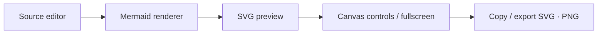

# Mermaid Preview

[](https://dbxio.com/cn/docs/plugin-development)
[](https://github.com/t8y2/dbx/blob/main/plugins/README.md)
[](https://mermaid.js.org/)
[](https://github.com/G3minius/dbx-mermaid/releases)
[](LICENSE)

[简体中文](README.md) · English

Write Mermaid inside DBX: source on the left, diagram on the right. No browser tab hopping, no CLI, no pasting source into an online rendering service.

> **Mermaid Preview (`dbx-mermaid`)** · standalone workbench · live rendering · pure frontend · zero permissions · fully offline



## Why it is worth using

| What you need to do | How Mermaid Preview helps |
| --- | --- |
| Sketch a flowchart on the spot | A standalone workbench inside DBX; renders about 300 ms after you stop typing |
| Paste a large snippet from elsewhere | Strips BOM and normalises CRLF to LF; syntax errors report a line number and keep the last good diagram |
| Inspect the details of a diagram | Pointer-anchored wheel zoom from 10% to 400%, drag to pan, double-click to fit, optional fullscreen |
| Hand the diagram to a colleague | Copy the source, or export SVG / PNG (PNG at 2× with the preview theme background) |
| View diagrams on a dark UI | Six built-in Mermaid themes; `auto` follows the DBX light/dark appearance |
| Pass a security review | Manifest `permissions: []`, no network calls, no CDN, no telemetry, and every render is sanitised with DOMPurify |

## Where it fits

- Design reviews and incident retrospectives where you need a flowchart or sequence diagram without leaving the DBX workspace.
- Drawing an ER diagram, state machine or class diagram before writing a design doc, then exporting it as SVG.
- Air-gapped or offline environments: no CDN dependency, Mermaid and DOMPurify ship with the plugin.
- Teams that want "editor + preview" as a fixed layout instead of switching tabs.

## What it does

- **Draggable split view**: line-numbered monospace source editor on the left, live preview on the right. The 8 px gutter can be dragged; wide screens split left/right, narrow screens split top/bottom.
- **Keyboard accessible**: the gutter supports arrow keys, PageUp/Down, Home/End, Enter and double-click reset (44/56); the canvas exposes four pan buttons so dragging is not the only way to move around.
- **Built-in samples**: Flowchart, Sequence, Class, State, ER, Gantt and Mindmap, with the flowchart sample loaded by default.
- **Canvas gestures**: wheel or trackpad pinch to zoom continuously, `Shift+wheel` to pan horizontally, drag with the left or middle button to pan, double-click to fit.
- **Fullscreen preview**: hides the editor and status bar, keeping only the diagram and its toolbar. This is an in-view immersive state and does not request browser fullscreen permission.
- **Themes and language**: UI in zh-CN or en; preview themes are `auto` (follows DBX), `default`, `forest`, `neutral`, `neo`, `dark` and `neo-dark`.
- **Copy and export**: copy the source, or save SVG / PNG through the host `fileTransfer` API. If the host cannot save files, or blocks PNG rasterisation, the action falls back to copying the SVG source with an explanation.
- **Recoverable errors**: a parse failure shows a plain-text message, snippet and line number. No partial SVG is mounted and your source stays untouched.
- **No persistence**: everything lives in memory and is discarded when the tab closes; nothing is written to host storage.

### Keyboard shortcuts

| Action | Shortcut |
| --- | --- |
| Render now | `Ctrl/Cmd + Enter` |
| Fit to window | `Ctrl/Cmd + 0` |
| Zoom in / out | `Ctrl/Cmd + +` / `Ctrl/Cmd + -` |
| Enter / exit fullscreen | `Ctrl/Cmd + Shift + F` / `Esc` |
| Pan the canvas | Arrow keys (canvas focused) |
| Adjust the split | Arrow keys, PageUp/Down, Home/End; Enter resets |
| Indent in the editor | `Tab` |

## Installation

### From a release

1. Open [Releases](https://github.com/G3minius/dbx-mermaid/releases) and download `io.github.g3minius.dbx-mermaid-<version>-universal.dbxp`.
2. In the DBX plugin center, go to Settings → Third-party and developer options and allow unsigned development packages.
3. Choose local install, pick the `.dbxp`, then open "Mermaid Preview" from the workbench.

### Build it yourself

```bash
npm ci
npm run check          # tsc --noEmit
npm test               # vitest run
npm run build          # web/ -> ui/, a single self-contained entry
npm run verify:bundle  # asserts one JS file in ui/assets with no dynamic imports
npx @dbx-app/plugin-cli package .
```

The package lands in `dist/<id>-<version>-universal.dbxp` and installs the same way.

> **Package the output of `npm run build`.** The build inlines Mermaid, DOMPurify and every diagram type's dynamic imports into a **single JS entry**. The DBX web/container host is not a Tauri runtime: it inlines the entry script into a `sandbox="allow-scripts"` `srcdoc` iframe whose CSP is only `'unsafe-inline' blob:` and which injects no `<base href>`. Any on-demand chunk `import()` then fails to resolve, and the first load reports "failed to load the rendering engine". See [Troubleshooting](#troubleshooting).

## Development

Requirements: Node.js **22.12.0+**, DBX `>=0.6.0` (Host API `1`), npm.

```bash
npm install

npm run dev             # Vite only; no window.dbxPlugin, so it shows the fallback page
npm run build:dev       # build used by the dev host
npm run build:dev:watch # watch build

# Browser dev host (triggers build:dev from dbx-plugin.toml)
npx @dbx-app/plugin-cli dev --path . --port 5190
```

- `npm run dev` is not a plugin host and cannot exercise real bridge capabilities. Check the UI in real DBX or under `dbx-plugin dev`.
- Before committing, run in this order: `npm run check` → `npm test` → `npm run build` → `npm run verify:bundle`.
- `ui/` and `dist/` are build outputs: do not edit or commit them.

### Project layout

```text
dbx-mermaid/
├── manifest.json                 # Manifest v1, a single workbench contribution
├── dbx-plugin.toml               # packaging and dev configuration
├── assets/plugin.svg             # plugin icon
├── docs/                         # container deployment notes, etc.
├── web/                          # sources (not packaged directly)
│   ├── index.html
│   └── src/
│       ├── main.ts               # boot, ready, workbench routing
│       ├── styles.css
│       ├── lib/                  # DBX bridge, source validation, rendering, raster, export, i18n, samples
│       ├── components/           # SourceEditor / MermaidCanvas / SplitPane
│       └── views/                # Workbench / Fallback
├── ui/                           # Vite output (git-ignored)
└── .github/workflows/            # release pipeline
```

Architecture boundaries: `lib/dbx.ts` is the only module that touches `window.dbxPlugin`, and views/components use only its narrow interface. `lib/mermaid.ts` owns engine loading, strict configuration, parse/render and result sanitisation. `lib/source.ts`, `lib/export.ts`, `lib/splitMath.ts`, `lib/canvasMath.ts` and friends stay pure so they can be unit tested in Node.

## Security design

- **Zero permissions**: `manifest.json` declares `permissions: []` — no network, database, clipboard read or persistence permissions.
- **Offline**: Mermaid and DOMPurify are npm dependencies bundled at build time. No CDN scripts, external fonts or external icons, and no telemetry, crash reporting or remote logging.
- **Source is treated as untrusted input**:
  - 50,000 character limit and `maxEdges: 500`;
  - rejects leading `click` directives, `javascript:`, `@{ img: ... }`, and `%%{init}%%` / `initialize` overrides;
  - Mermaid runs with `securityLevel: "strict"` + `htmlLabels: false` + `suppressErrorRendering`;
  - output is sanitised by DOMPurify (`RETURN_DOM_FRAGMENT`) and then asserted as SVG: no event attributes, no `<script>` or `foreignObject`, `href` may only be empty or `#`, and `<style>` may not contain `javascript:`, `@import` or non-`#` `url()`.
- **DOM writes**: only an SVG fragment that passed the assertions is mounted; `innerHTML` is never used, and error text is written with `textContent`.
- **PNG never touches the network**: rasterisation only consumes the sanitised SVG. A tainted canvas degrades to copying the SVG source rather than bypassing same-origin rules.

## Container and remote deployment

The plugin is a pure frontend artefact (`assets` + `ui`) with no sidecar. Three things usually go wrong when deploying to a Docker or web host:

1. Persist `DBX_DATA_DIR` (default `/app/data`); plugins unpack into `$DBX_DATA_DIR/plugins`. A lost volume shows up as a blank workbench.
2. Wait until the backend is fully ready before installing the plugin; while a data migration is pending, APIs answer `423 LOCKED`.
3. Have your reverse proxy pass the `dbx_session` cookie through and not swallow `/api/plugins/`.

The full compose file, `docker run` equivalent, 401/423/404 troubleshooting and verification commands are in **[Container and remote deployment](docs/container-deployment.md)** (Chinese).

## Troubleshooting

| Symptom | Cause / fix |
| --- | --- |
| "Failed to load the rendering engine", retry keeps failing | The bundle contains on-demand chunks (`inlineDynamicImports` was changed). Restore the single entry → `npm run build` + `verify:bundle` → repackage and reinstall with a bumped version |
| First open reports `Unable to preload CSS` | `cssCodeSplit` was enabled. Set it back to `false` and rebuild |
| The "unknown contribution" fallback page opens | `WORKBENCH_ID` no longer matches the manifest contribution id, or `PLUGIN_ID` was edited |
| UI changes do not appear / a new package has no effect | The host caches sandbox documents per `<pluginId>:<version>`; bump `version` in `manifest.json` and reinstall |
| `manifest.json contains unknown top-level field(s)` | Manifest v1 rejects custom fields; remove the undeclared ones |
| `manifest UI entry ... is not covered by [package].include` | `[package].include` is missing `ui`, or the entry sits outside its root |
| `Package include ui does not exist` | `npm run build` was not run before packaging |
| PNG export turns into "SVG source copied" | The host lacks `fileTransfer`, or CSP blocks PNG rasterisation; use SVG export instead |
| `npm test` fails in `describe()` with `Cannot read properties of undefined (reading 'config')` | Vitest 5 + Node 22 on Windows thread-pool issue; `vitest.config.ts` pins `pool: "vmThreads"` — do not touch `globals` or downgrade |
| `vite:esbuild-transpile ... Access is denied` on Windows | Locked esbuild temp files under `%TEMP%`, unrelated to the code. Point `TEMP`/`TMP` at a repo-local directory such as `.tmp` and rerun |

## Known limitations

- **No full on-device acceptance yet**: saving SVG / text and PNG binaries via `fileTransfer`, PNG rasterisation under the host CSP, theme tokens on desktop WebView2 and container web hosts, and whether the host steals the fullscreen shortcut still need verification in real DBX. `dbx-plugin dev` does not emulate these capabilities.
- **Markdown fences are not stripped**: a `` ```mermaid `` fence copied from Markdown fails to parse; the error message reminds you to remove it.
- **No persistence**: closing the tab resets the source, zoom level and fullscreen state.
- **Built-in themes only**: no `themeVariables` are injected, and source code cannot override render configuration.

## Contributing

1. Branch off `main` with a short-lived name: `feat/<slug>`, `fix/<slug>`, `docs/<slug>` or `chore/<slug>`.
2. Use Conventional Commits, for example `feat(workbench): support SVG export`.
3. Add pure-function tests in `web/src/lib/*.test.ts` before changing behaviour; gesture and conversion logic belongs in `lib/`, DOM events in `components/`.
4. Make sure `npm run check`, `npm test`, `npm run build` and `npm run verify:bundle` all pass. Never commit `ui/`, `dist/` or `node_modules/`.

## Links

- [DBX plugin development docs](https://dbxio.com/cn/docs/plugin-development)
- [DBX plugin platform protocol](https://github.com/t8y2/dbx/blob/main/plugins/README.md)
- [Mermaid documentation](https://mermaid.js.org/)
- [Mermaid securityLevel](https://mermaid.js.org/config/usage.html#securitylevel)
- [Issues](https://github.com/G3minius/dbx-mermaid/issues)

## License

[MIT](LICENSE) © 2026 g3minius

[Mermaid](https://github.com/mermaid-js/mermaid) is MIT licensed and [DOMPurify](https://github.com/cure53/DOMPurify) is dual licensed under Apache-2.0 / MPL-2.0; their notices ship with the build output.

---

Plugin ID: `io.github.g3minius.dbx-mermaid` · Publisher: `g3minius`
