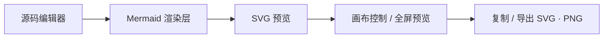

# Mermaid 预览

[](https://dbxio.com/cn/docs/plugin-development)
[](https://github.com/t8y2/dbx/blob/main/plugins/README.md)
[](https://mermaid.js.org/)
[](https://github.com/G3minius/dbx-mermaid/releases)
[](LICENSE)

简体中文 · [English](README.en.md)

在 DBX 里写 Mermaid，左边是源码，右边就是图。不用切浏览器，不用装 CLI，也不用把源码贴到任何在线渲染服务。

> **Mermaid 预览（`dbx-mermaid`）** · 独立工作台 · 实时渲染 · 纯前端 · 零权限 · 完全离线



## 为什么值得用

| 你要完成的事 | Mermaid 预览给你的体验 |
| --- | --- |
| 临时画一张流程图 | DBX 内独立工作台，打开即用，输入后约 300ms 自动渲染 |
| 从别处粘贴一大段源码 | 自动去 BOM、统一换行为 LF；语法错误直接给出行号并保留上一张成功的图 |
| 看清图里的细节 | 滚轮以指针为锚点缩放 10%–400%，拖拽平移，双击适应，可切全屏 |
| 把图交给同事或放进文档 | 复制源码，或导出 SVG / PNG（PNG 为 2× 分辨率、铺预览主题底色） |
| 在深色界面里看图 | 6 个 Mermaid 内置主题，默认 `auto` 跟随 DBX 明暗外观 |
| 通过安全与合规审查 | Manifest `permissions: []`，无网络请求、无 CDN、无埋点，渲染结果经 DOMPurify 净化 |

## 适合场景

- 需求评审、故障复盘时随手画一张流程图或时序图，直接留在 DBX 工作区里。
- 写设计文档前先画 ER 图、状态机、类图，再从插件里导出 SVG。
- 内网或离线环境：不依赖 CDN，Mermaid 与 DOMPurify 随插件本地打包。
- 需要把「编辑器 + 预览」固定成一套独立布局，而不是在标签页之间来回切。

## 核心能力

- **可拖拽分栏**：左侧是带行号的等宽源码编辑器，右侧实时预览；中间 8px 分隔条可拖拽，宽屏左右分、窄屏上下分。
- **键盘可达**：分隔条支持方向键、PageUp/Down、Home/End、Enter 与双击复位（44/56）；画布提供四向平移按钮，不依赖鼠标拖拽。
- **内置示例**：Flowchart、Sequence、Class、State、ER、Gantt、Mindmap 各一份，默认载入 flowchart 示例。
- **画布手势**：滚轮 / 触控板捏合连续缩放，`Shift+滚轮` 横移，左键或中键拖拽平移，双击适应窗口。
- **全屏预览**：隐藏编辑器与状态栏，只保留图与工具条；这是插件视图内的沉浸态，不申请浏览器全屏权限。
- **主题与语言**：界面支持 zh-CN / en；预览主题可选 `auto`（跟随 DBX）、`default`、`forest`、`neutral`、`neo`、`dark`、`neo-dark`。
- **复制与导出**：复制源码；优先通过宿主 `fileTransfer` 保存 SVG / PNG。宿主缺少保存能力，或阻断 PNG 光栅化时，自动降级为复制 SVG 源码并提示。
- **错误可恢复**：解析失败只显示纯文本消息、片段与行号，不挂载半成品 SVG，也不清空你正在编辑的源码。
- **不持久化**：状态全在内存，关闭标签页即丢弃，不写入宿主存储。

### 快捷键

| 操作 | 快捷键 |
| --- | --- |
| 立即渲染 | `Ctrl/Cmd + Enter` |
| 适应窗口 | `Ctrl/Cmd + 0` |
| 放大 / 缩小 | `Ctrl/Cmd + +` / `Ctrl/Cmd + -` |
| 进入 / 退出全屏 | `Ctrl/Cmd + Shift + F` / `Esc` |
| 平移画布 | 方向键（画布聚焦时） |
| 调整分栏 | 方向键、PageUp/Down、Home/End；Enter 复位 |
| 编辑器缩进 | `Tab` |

## 安装

### 从 Releases 安装

1. 打开 [Releases](https://github.com/G3minius/dbx-mermaid/releases)，下载 `io.github.g3minius.dbx-mermaid-<version>-universal.dbxp`。
2. 在 DBX 插件中心 → 设置 → 第三方与开发者选项，允许安装未签名开发包。
3. 选择本地安装并选中该 `.dbxp`，然后从工作台打开「Mermaid 预览」。

### 自行构建

```bash
npm ci
npm run check          # tsc --noEmit
npm test               # vitest run
npm run build          # web/ -> ui/，单入口自包含产物
npm run verify:bundle  # 断言 ui/assets 只有一个 JS，且无动态 import
npx @dbx-app/plugin-cli package .
```

产物为 `dist/<id>-<version>-universal.dbxp`，安装方式同上。

> **必须用 `npm run build` 的产物打包。** 构建把 Mermaid / DOMPurify 和全部图表类型的动态 import 内联成**单个 JS 入口**。DBX 的 Web / 容器宿主不是 Tauri 运行时，它把入口脚本内联进 `sandbox="allow-scripts"` 的 `srcdoc` iframe，CSP 只有 `'unsafe-inline' blob:` 且不注入 `<base href>`；任何按需 chunk 的 `import()` 都无法解析，首次加载会报「渲染引擎加载失败」。详见 [常见问题](#常见问题)。

## 开发

环境要求：Node.js **22.12.0+**、DBX `>=0.6.0`（Host API `1`）、npm。

```bash
npm install

npm run dev             # 只起 Vite，没有 window.dbxPlugin，会显示降级页
npm run build:dev       # 开发宿主用的构建
npm run build:dev:watch # 监听构建

# 浏览器开发宿主（会触发 dbx-plugin.toml 里的 build:dev）
npx @dbx-app/plugin-cli dev --path . --port 5190
```

- `npm run dev` 不是插件宿主，看不到真实桥接能力；判断 UI 是否正常请在真实 DBX 或 `dbx-plugin dev` 中看。
- 提交前顺序固定：`npm run check` → `npm test` → `npm run build` → `npm run verify:bundle`。
- `ui/`、`dist/` 都是构建产物，不要手改、不要提交。

### 项目结构

```text
dbx-mermaid/
├── manifest.json                 # 插件清单（Manifest v1，仅一个 workbench）
├── dbx-plugin.toml               # 打包与 dev 配置
├── assets/plugin.svg             # 插件图标
├── docs/                         # 容器部署说明等
├── web/                          # 源码（不直接打包）
│   ├── index.html
│   └── src/
│       ├── main.ts               # 启动、ready、workbench 路由
│       ├── styles.css
│       ├── lib/                  # dbx 桥接、源码校验、渲染、光栅化、导出、i18n、示例
│       ├── components/           # SourceEditor / MermaidCanvas / SplitPane
│       └── views/                # Workbench / Fallback
├── ui/                           # Vite 构建产物（git 忽略）
└── .github/workflows/            # 发布流水线
```

架构边界：`lib/dbx.ts` 是唯一直接访问 `window.dbxPlugin` 的模块；视图与组件只使用它的窄接口。`lib/mermaid.ts` 负责引擎加载、strict 配置、parse/render 与结果净化；`lib/source.ts`、`lib/export.ts`、`lib/splitMath.ts`、`lib/canvasMath.ts` 等保持纯函数，可在 Node 下直接单测。

## 安全设计

- **零权限**：`manifest.json` 的 `permissions` 为 `[]`，不申请网络、数据库、剪贴板读取或持久化。
- **离线**：Mermaid、DOMPurify 是 npm 依赖，构建时打包进产物；不加载 CDN、外部字体或外部图标，也没有埋点与远程日志。
- **源码按不可信输入处理**：
  - 50,000 字符上限，`maxEdges: 500`；
  - 拒绝行首 `click` 指令、`javascript:`、`@{ img: ... }`、`%%{init}%%` / `initialize` 覆盖；
  - Mermaid `securityLevel: "strict"` + `htmlLabels: false` + `suppressErrorRendering`；
  - 渲染结果先经 DOMPurify（`RETURN_DOM_FRAGMENT`）净化，再过一遍 SVG 断言：禁止事件属性、`<script>` / `foreignObject`，`href` 只允许空或 `#`，`<style>` 内禁止 `javascript:`、`@import` 和非 `#` 的 `url()`。
- **DOM 写入**：只有通过断言的 SVG fragment 会被挂载，不用 `innerHTML`；错误信息一律 `textContent`。
- **PNG 不触网**：光栅化只消费已净化的 SVG，canvas 被污染时降级为复制 SVG 源码，不绕过同源策略。

## 容器与远程部署

插件是纯前端产物（`assets` + `ui`），没有 Sidecar。部署到 Docker / Web 宿主时最容易踩的三件事：

1. 必须持久化 `DBX_DATA_DIR`（默认 `/app/data`），插件解包在 `$DBX_DATA_DIR/plugins`；卷丢失会表现成「工作台空白」。
2. 必须等后端完全就绪再装插件，数据迁移未完成时 API 统一返回 `423 LOCKED`。
3. 反向代理要透传 `dbx_session` Cookie，并且不要吞掉 `/api/plugins/`。

完整的 compose 示例、`docker run`、401/423/404 排查与验收命令见 **[容器与远程部署](docs/container-deployment.md)**。

## 常见问题

| 现象 | 原因 / 修法 |
| --- | --- |
| 显示「渲染引擎加载失败」，点重试反复失败 | 产物里出现了按需 chunk（`inlineDynamicImports` 被改掉）。恢复单入口 → `npm run build` + `verify:bundle` → 重新打包并递增版本重装 |
| 首次打开报 `Unable to preload CSS` | `cssCodeSplit` 被打开。设回 `false` 后重新构建 |
| 打开的是「未知贡献点」降级页 | `WORKBENCH_ID` 与 manifest 贡献点 id 不一致，或 `PLUGIN_ID` 被改动 |
| 改了 UI 但界面没变 / 换包不生效 | 宿主按 `<pluginId>:<version>` 缓存沙箱文档，必须递增 `manifest.json` 的 `version` 后重装 |
| `manifest.json contains unknown top-level field(s)` | Manifest v1 不接受自造字段，删掉未声明字段 |
| `manifest UI entry ... is not covered by [package].include` | `[package].include` 缺 `ui`，或 entry 不在 root 内 |
| `Package include ui does not exist` | 打包前没执行 `npm run build` |
| PNG 导出变成「已复制 SVG 源码」 | 宿主缺少 `fileTransfer`，或 CSP 阻断了 PNG 光栅化；改用 SVG 导出即可 |
| `npm test` 在 `describe()` 报 `Cannot read properties of undefined (reading 'config')` | Vitest 5 + Node 22（Windows）默认线程池问题；`vitest.config.ts` 固定 `pool: "vmThreads"`，不要改 `globals` 或降级依赖 |
| Windows 上 `vite:esbuild-transpile ... Access is denied` | `%TEMP%` 下的 esbuild 临时文件被锁，与代码无关。把 `TEMP`/`TMP` 指到仓库内目录（如 `.tmp`）后重跑 |

## 已知限制

- **未做真机全量验收**：`fileTransfer` 保存 SVG / 文本与 PNG 二进制、PNG 光栅化在宿主 CSP 下是否可用、桌面 WebView2 与容器 Web 宿主的主题 token、全屏快捷键是否被宿主占用，仍需在真实 DBX 中复验。`dbx-plugin dev` 不模拟这些能力。
- **不自动剥离 Markdown 围栏**：从 Markdown 复制来的 `` ```mermaid `` 围栏会解析失败，错误提示里会提醒去掉围栏。
- **不持久化**：关闭标签页后源码、缩放倍率、全屏态全部回到默认。
- **只用 Mermaid 内置主题**：不注入 `themeVariables`，也不允许源码覆盖渲染配置。

## 贡献

1. 从 `main` 拉出短生命周期分支：`feat/<slug>`、`fix/<slug>`、`docs/<slug>`、`chore/<slug>`。
2. 提交信息遵循 Conventional Commits，例如 `feat(workbench): 支持 SVG 导出`。
3. 改动行为前先补 `web/src/lib/*.test.ts` 里的纯函数用例；手势与换算逻辑必须留在 `lib/`，DOM 事件留在 `components/`。
4. 提交前确保 `npm run check`、`npm test`、`npm run build`、`npm run verify:bundle` 全部通过；不要提交 `ui/`、`dist/`、`node_modules/`。

## 相关链接

- [DBX 插件开发文档](https://dbxio.com/cn/docs/plugin-development)
- [DBX 插件平台协议](https://github.com/t8y2/dbx/blob/main/plugins/README.md)
- [Mermaid 文档](https://mermaid.js.org/)
- [Mermaid securityLevel](https://mermaid.js.org/config/usage.html#securitylevel)
- [Issues](https://github.com/G3minius/dbx-mermaid/issues)

## 许可证

[MIT](LICENSE) © 2026 g3minius

第三方依赖 [Mermaid](https://github.com/mermaid-js/mermaid) 使用 MIT 许可证，[DOMPurify](https://github.com/cure53/DOMPurify) 使用 Apache-2.0 / MPL-2.0 双许可证，声明随构建产物一并分发。

---

插件 ID：`io.github.g3minius.dbx-mermaid` · 发布者：`g3minius`
