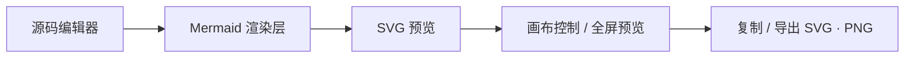

# dbx-mermaid

[](https://dbxio.com/cn/docs/plugin-development)
[](https://github.com/t8y2/dbx/blob/main/plugins/README.md)
[](https://mermaid.js.org/)
[](#许可证)

一个运行在 DBX 里的独立 Mermaid 实时编辑器：**左侧写代码，右侧看渲染图**。不依赖数据库查询结果，不访问网络，Mermaid 随插件本地打包。

> **状态：MVP 已实现，等待真实 DBX 验收**
> 工作台、实时渲染、示例、滚轮缩放/拖拽平移/全屏预览、可拖拽分栏、复制、SVG 与 PNG 导出、明暗主题与中英文界面已完成。
> 真实 DBX 中的 `fileTransfer` 保存、PNG 光栅化 CSP 与全屏快捷键仍需手工复验（`dbx-plugin dev` 不模拟）。



## 特性

- **可拖拽分栏**：左侧 Mermaid 源码编辑器（行号、等宽字体），右侧实时预览；中间 8px 分隔条可拖拽，宽屏左右分、窄屏上下分，方向键 / PageUp/Down / Home/End 可键盘调整，双击或 Enter 复位 44/56。全屏时自动隐藏、退出后比例保留。
- **实时渲染**：输入后约 300ms 自动更新；`Ctrl/Cmd+Enter` 立即渲染。
- **内置示例**：Flowchart、Sequence、Class、State、ER、Gantt、Mindmap；默认载入 Christmas flowchart 示例。
- **画布控制**：滚轮以指针为锚点连续缩放（10%–400%，触控板捏合同路径），`Shift+滚轮` 横移，左键/中键拖拽平移，双击适应；右下四向平移按钮与方向键是拖拽的单点替代（WCAG 2.2 SC 2.5.7）。
- **缩放/适应**：`Ctrl/Cmd+0` 适应、`Ctrl/Cmd+±` 阶跃缩放、点击百分比回 100%；主题、语言、全屏切换都不重置倍率。
- **全屏预览**：预览占满插件视图，隐藏编辑器与状态栏；「全屏」按钮或 `Ctrl/Cmd+Shift+F` 进入，`Esc` 或退出按钮退出；纯视图内沉浸态，不依赖浏览器全屏权限。
- **错误可恢复**：解析失败显示行号与纯文本错误，保留上一次成功图；修复后自动恢复。
- **安全优先**：`securityLevel: "strict"`、`htmlLabels: false`、源码长度上限、DOMPurify + SVG 安全断言。
- **离线可用**：Mermaid/DOMPurify 全部打包，不加载 CDN、外部字体或外部图标。
- **主题跟随**：使用 DBX design tokens，明/暗主题自动切换并重新渲染。
- **中英文界面**：zh-CN / en；Manifest 本地化只覆盖插件/贡献点元数据，UI 文案由插件自己翻译。
- **复制与导出**：复制源码；`导出 [SVG] [PNG]` 优先用宿主 `fileTransfer` 保存文件（PNG 为 2× 分辨率、按预览主题铺不透明底色），缺失保存能力或宿主阻断 PNG 光栅化时降级为复制 SVG 源码。PNG 全程纯前端，不引入 Sidecar、headless Chromium 或新依赖。
- **不持久化**：Manifest `permissions: []`；关闭标签页后源码、缩放倍率与全屏态丢失。

## 环境要求

| 项 | 要求 |
| --- | --- |
| Node.js | **22.12.0+**（`dbx-plugin dev` 硬性要求，当前验证机为 24.18.1） |
| DBX | `>=0.6.0`，Host API `1` |
| 包管理器 | npm（仓库内提交 `package-lock.json`） |

## 快速开始

```bash
# 安装依赖
npm install

# 类型检查
npm run check

# 单元测试
npm test

# 生产构建（web/ → ui/，单文件自包含，无动态 chunk）
npm run build
npm run verify:bundle   # 校验 ui/assets 只剩一个 JS 入口

# 开发宿主构建（同样内联动态 import；dbx-plugin dev 由 dbx-plugin.toml 触发）
npm run build:dev
npm run build:dev:watch

# 仅前端预览（没有 window.dbxPlugin，会显示降级页）
npm run dev
```

### 在 DBX 中调试

```bash
# 浏览器开发宿主（会自动执行 dbx-plugin.toml 中的 build:dev）
npx @dbx-app/plugin-cli dev --path . --port 5190

# 打包未签名开发包（先生产构建）
npm run build
npx @dbx-app/plugin-cli package .
```

产物为 `dist/<id>-<version>-universal.dbxp`。在 DBX 插件中心 → 设置 → 第三方与开发者选项 → 允许安装未签名开发包，然后安装该 `.dbxp` 即可。

> **生产包必须自包含**：`npm run build` 与 `npm run build:dev` 都会把 Mermaid / DOMPurify 及全部图表类型的动态 import 内联成**单个 JS 入口**（`vite.config.ts` 的 `inlineDynamicImports: true`）。DBX 的 Web/容器宿主不是 Tauri 运行时，无法使用 `dbx-plugin://` 资源协议；它把入口脚本内联进 `sandbox="allow-scripts"` 的 srcdoc iframe，CSP 为 `script-src 'unsafe-inline' blob:` 且不注入 `<base href>`。此时任何动态 `import()` 都无法解析到插件资源，首次 `import("mermaid")` 会 reject 并显示「渲染引擎加载失败，请重试或重新打开视图」，点「重试」只会重复同一次失败。桌面宿主虽支持按需 chunk，但内联产物同样可用，因此统一使用单入口构建。
>
> 改完构建配置必须重新 `npm run build`、重新 `dbx-plugin package .`，并在插件中心**递增版本后重装**（宿主按 `id:version` 缓存沙箱文档，旧包不会自动修复）。

> **Windows 提示**：部分 `@dbx-app/plugin-cli` 版本在 Windows 上会把项目路径规范化为 `\\?\F:\...`，导致 `ui_build` 中的 npm 命令报 `UNC paths are not supported`。可先手动执行 `npm run build:dev`，临时移除 `dbx-plugin.toml` 的 `[dev]` 段后启动 dev host，或直接在真实 DBX 中验收。该问题属于 CLI 的路径处理，不是插件代码。

> `dbx-plugin dev` 不模拟 `fileTransfer`、桌面主题细节与完整组件 kit；这些必须在真实 DBX 中复验。

### 容器版（Docker / Web 宿主）部署要点

官方镜像 `t8y2/dbx:latest` 的 `CMD` 是 `dbx-web`，`EXPOSE 4224`，内置 `DBX_STATIC_DIR=/app/static`、`DBX_DATA_DIR=/app/data`、`DBX_BACKUP_ROOT=/app/backups`。推荐发布版 compose：

```yaml
services:
  dbx:
    image: t8y2/dbx:latest            # 国内可用 docker.cnb.cool/dbxio.com/dbx:latest
    pull_policy: always
    ports:
      - "4224:4224"
    environment:
      DBX_PASSWORD: "<强密码>"        # 生产必填；否则 /api/* 的鉴权行为会随数据库状态变化
      DBX_PORT: "4224"               # 必须与 ports 的容器侧端口一致
      DBX_DATA_DIR: "/app/data"      # 插件包解包在 $DBX_DATA_DIR/plugins
      DBX_BACKUP_ROOT: "/app/backups"
      DBX_PUBLIC_BASE_PATH: "/"      # 子路径部署时改成 /dbx，并与反向代理前缀一致
      # DBX_SECRET_KEY_FILE: /run/secrets/dbx_secret_key
    volumes:
      - dbx-data:/app/data
      - dbx-backups:/app/backups
    # 官方镜像基于 debian:bookworm-slim，不含 curl/wget，故用 bash 的 /dev/tcp 做 TCP 就绪探测；
    # HTTP 层就绪再由下方的 /api/auth/check 轮询确认。
    healthcheck:
      test: ["CMD", "bash", "-c", "exec 3<>/dev/tcp/127.0.0.1/4224"]
      interval: 5s
      timeout: 3s
      retries: 20
      start_period: 15s
    stop_grace_period: 90s
    restart: unless-stopped

volumes:
  dbx-data:
  dbx-backups:
```

等价的 `docker run`：

```bash
docker run -d --pull=always --name dbx \
  -p 4224:4224 \
  -e DBX_PASSWORD='<强密码>' -e DBX_PORT=4224 \
  -e DBX_DATA_DIR=/app/data -e DBX_BACKUP_ROOT=/app/backups \
  -e DBX_PUBLIC_BASE_PATH=/ \
  -v dbx-data:/app/data -v dbx-backups:/app/backups \
  --stop-timeout 90 --restart unless-stopped \
  t8y2/dbx:latest
```

启动初始化与资源加载的四个硬性约束：

1. **必须持久化 `/app/data`**：插件解包目录是 `$DBX_DATA_DIR/plugins`。容器重建且卷丢失时，插件中心看起来还在装，但 `GET /api/plugins/<id>/ui` 与 `/ui/<path>` 会 404，表现为「工作台空白 / 渲染引擎加载失败」。
2. **必须等后端完全就绪再装插件**：`docker compose up -d` 后等 healthcheck 通过，再由插件中心安装 `.dbxp`。数据卷从旧版本升级时，若数据迁移未完成，`auth_middleware` 之后的 `migration_gate` 会让除 `auth/*`、`migration/*`、`ping` 外的所有 API 返回 `423 LOCKED / DATA_MIGRATION_REQUIRED`，其中就包括插件资源读取；此时安装/打开工作台必然失败。先在 Web 界面完成「数据安全升级」向导再继续。
   ```bash
   docker compose up -d
   until curl -fsS http://127.0.0.1:4224/api/auth/check >/dev/null; do sleep 1; done
   ```
3. **插件资源走带会话的 API，不是静态文件**：Web 宿主用 `GET /api/plugins/<id>/ui` 与 `/api/plugins/<id>/ui/<path>` 读入口与资源，再内联进 `srcdoc`。这些路由在 `auth_middleware` 之后，只有 `auth/login|setup|check|captcha` 免鉴权，其余一律需要 `dbx_session` Cookie；无会话时实测返回 `401`。反向代理必须透传 `Cookie`，不要改写 `Host`/`Origin`，不要吞掉 `/api/plugins/`，也不要额外注入与之冲突的 `Content-Security-Policy`。HTTPS 反向代理需设 `DBX_WEB_COOKIE_SECURE=1`，否则 `Secure` 标志缺失只是安全降级（不会导致 401）；真正易踩的是 Cookie 的 `Path` 等于 `DBX_PUBLIC_BASE_PATH`——`DBX_PUBLIC_BASE_PATH=/dbx` 时整个 app（含 `/api`）会被 nest 到该前缀，代理必须把同一前缀原样转给容器，否则浏览器不会带上 Cookie，插件资源全部 401。该变量也影响 DBX 自身前端的资源基址（源码构建对应 `VITE_DBX_BASE_PATH=/dbx/`），与本插件 `ui/` 产物无关。
4. **改包必须递增版本并重装**：宿主按 `<pluginId>:<version>` 缓存沙箱文档（LRU），监听 `dbx:plugins-changed` 才清空。沿用旧版本号时浏览器仍会用缓存里的旧 `index.html` 和旧 chunk 列表，替换 `.dbxp` 也不会生效。`manifest.json` 当前为 `1.0.0`（首个正式版本：可拖拽分栏 + PNG 导出），安装后请关闭旧工作台标签再重新打开。

验收（登录后带 Cookie 执行，或直接看浏览器 Network 面板）：

```bash
# 入口：返回 { "dataBase64": "...", "contentType": "text/html" }，解码后应只有 1 个 JS + 1 个 CSS 引用
curl -fsS -b 'dbx_session=<从浏览器 DevTools 复制>' \
  http://127.0.0.1:4224/api/plugins/io.github.g3minius.dbx-mermaid/ui \
  | python3 -c 'import sys,json,base64;print(base64.b64decode(json.load(sys.stdin)["dataBase64"]).decode())'

# 单入口 JS：200；浏览器 Network 面板中不应再出现 mermaid.core-*.js 之类的 chunk 请求
curl -fsS -o /dev/null -w '%{http_code} %{size_download}\n' -b 'dbx_session=<...>' \
  http://127.0.0.1:4224/api/plugins/io.github.g3minius.dbx-mermaid/ui/assets/index-w9SMrKdj.js
```

容器内自检包内容（确认没有残留动态 chunk）：

```bash
unzip -l dist/io.github.g3minius.dbx-mermaid-1.0.0-universal.dbxp | grep 'ui/assets'
# 应只有 index-<hash>.js 与 style-<hash>.css 两个文件
```

## 项目结构

```text
dbx-mermaid/
├── manifest.json                 # 插件清单（Manifest v1，仅一个 workbench）
├── dbx-plugin.toml               # 打包与 dev 配置（dev 使用 build:dev）
├── assets/plugin.svg             # 插件图标
├── docs/                         # 设计与实现分析（本地文档）
├── web/                          # 源码（不直接打包）
│   ├── index.html
│   └── src/
│       ├── main.ts               # 启动、ready、workbench 路由
│       ├── styles.css
│       ├── lib/                  # dbx 桥接、源码校验、渲染、光栅化、导出、i18n、示例
│       ├── components/           # SourceEditor / MermaidCanvas / SplitPane
│       └── views/                # Workbench / Fallback
├── ui/                           # Vite 构建产物（git 忽略）
└── .github/workflows/            # 发布流水线
```

架构约定：`lib/dbx.ts` 是唯一直接访问 `window.dbxPlugin` 的模块；视图与组件只使用它的窄接口。`lib/mermaid.ts` 负责渲染引擎获取（源码按需 `import()`，构建时全部内联）、strict 配置、parse/render、DOMPurify 与 SVG 安全断言。`lib/splitMath.ts` 与 `lib/raster.ts` 的纯函数可在 Node 环境单测；PNG 光栅化只消费已净化的 SVG，不发起网络请求。

> **PNG 与宿主 CSP**：PNG 通过 `data:` → `blob:` → `createImageBitmap(Blob)` 三级解码绕过不同宿主的 `img-src` 差异。容器/Web 宿主可能同时阻断前两条，旧 WebView2 也可能不支持 SVG 的 `createImageBitmap`；此时按钮会降级为复制 SVG 源码并提示改用 SVG 导出，不会产出损坏的 PNG。请在真实 DBX 中确认该宿主是否可直接保存 PNG。

## 安全与隐私

- Manifest `permissions` 为 `[]`：不申请网络、数据库读取、剪贴板读取或持久化权限。
- 不加载 CDN 脚本、外部字体、外部图标；不包含埋点、崩溃上报或远程日志。
- 用户粘贴的源码按不可信输入处理：
  - 50,000 字符上限；`maxEdges: 500`；
  - 拒绝 `click` 指令、`javascript:` 链接、图片节点语法和 `%%{init}%%` 覆盖；
  - Mermaid `strict` + `htmlLabels: false`；
  - DOMPurify SVG 净化 + 最终 SVG 断言（无 `<script>`、事件属性、外部 URL）。
- 错误信息、源码片段、状态文本只用 `textContent` 写入 DOM。
- 关闭标签页后内容不保留；不会写入宿主存储。

## 验证命令

```bash
npm run check
npm test
npm run build
npm run verify:bundle
node <dbx-plugin-skill>/scripts/check-project.mjs .
npx @dbx-app/plugin-cli package .
```

真实 DBX 手工验收清单：

- [ ] 插件中心打开工作台，默认 flowchart 正常显示。
- [ ] 7 个内置示例均可渲染；切换示例时覆盖确认条生效。
- [ ] 非法语法显示错误行号并保留上次成功图；修复后恢复。
- [ ] 明/暗主题、zh-CN/en 切换后重新渲染。
- [ ] 滚轮缩放（含触控板捏合）指针锚点不漂；拖拽平移、四向按钮、方向键、双击适应均可用。
- [ ] 缩放/适应/快捷键正常，主题与语言切换后倍率不重置。
- [ ] 全屏进入/退出（按钮、快捷键、Esc）、焦点归还、深色预览主题下工具条文字可读、窄屏不溢出。
- [ ] 复制源码成功。
- [ ] 拖拽分栏（宽屏/窄屏）、键盘调整、双击/Enter 复位、全屏进出后比例保留均正常。
- [ ] 支持 `fileTransfer` 的宿主保存 SVG 与 PNG 成功；PNG 为 2× 且深色预览主题下文字可读；取消不报错。
- [ ] 不支持保存或 PNG 光栅化被宿主阻断时，降级为复制 SVG 源码并给出提示。
- [ ] 安全样本不产生 `<script>`、事件属性或外部资源引用。
- [ ] **容器版**：等待后端就绪后安装 `1.0.0` 包，Network 面板中插件 UI 只有 1 个 JS + 1 个 CSS 请求，无 `mermaid.core-*.js` 等 chunk 请求。
- [ ] **容器版**：默认 flowchart 正常渲染；主动点「重试」不再出现「渲染引擎加载失败」。
- [ ] **容器版**：`docker compose restart dbx` 后（卷保留）重新打开工作台仍可渲染。

## 贡献

1. 先读 [AGENTS.md](AGENTS.md)（开发约定、边界、提交规范）与 [Mermaid 插件实现方案分析](docs/mermaid-plugin-analysis.md)。
2. 从 `main` 拉出短生命周期分支：`feat/<slug>`、`fix/<slug>`、`docs/<slug>`、`chore/<slug>`。
3. 提交信息遵循 Conventional Commits，例如 `feat(workbench): 支持 SVG 导出`。
4. 提交前确保 `npm run check`、`npm test`、`npm run build` 全部通过；不要提交 `ui/`、`dist/`、`node_modules/`。

## 相关链接

- [DBX 插件开发文档](https://dbxio.com/cn/docs/plugin-development)
- [DBX 插件平台协议](https://github.com/t8y2/dbx/blob/main/plugins/README.md)
- [Mermaid 官方文档](https://mermaid.js.org/)
- [仓库地址](https://github.com/G3minius/dbx-mermaid)

## 许可证

本仓库尚未包含 `LICENSE` 文件。在明确选定开源许可证之前，代码默认保留所有权利（All rights reserved）。

第三方依赖 [Mermaid](https://github.com/mermaid-js/mermaid) 使用 MIT 许可证，其声明随构建产物一并分发；[DOMPurify](https://github.com/cure53/DOMPurify) 使用 Apache-2.0 / MPL-2.0 双许可证（以依赖产物中的声明为准）。

---

插件 ID：`g3minius.dbx-mermaid` · 发布者：`g3minius`
